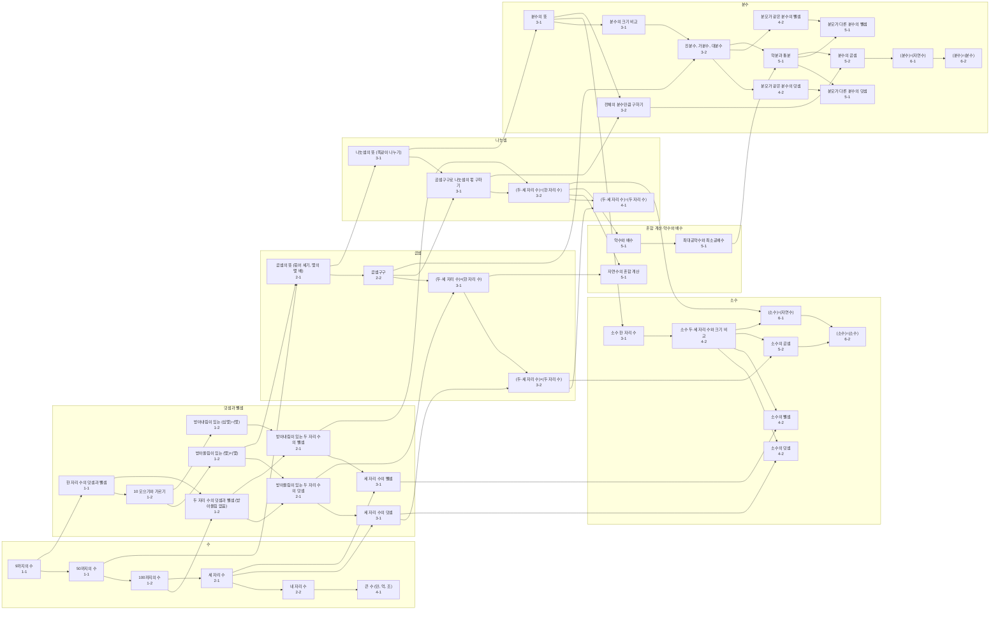

# 개념 지도: 수와 연산 (1~6학년)

> 이 문서는 `npm run docs:concept-map`이 코드(`src/domain/curriculum/skills.ts`)에서 만듭니다. 직접 고치지 말고 코드를 고친 뒤 다시 만드세요.

- 개념 45개, 계열 7개, 대표 오개념 44개
- **선수 개념**은 실제 학습 의존 관계만 적습니다(교과서 순서만으로는 연결하지 않음). 진단은 이 연결을 따라 숙달·결손을 추론합니다.
- **학년-학기**는 교과서의 대표 배치입니다. 3~6학년은 검정 교과서라 출판사마다 단원 순서가 조금 다를 수 있습니다.
- **성취기준**은 학년군과 영역(`[2수01-…]`, `[4수01-…]`, `[6수01-…]`)까지만 적었습니다. 정확한 번호는 2022 개정 교육과정 원문과 대조해 채워야 합니다(원문 PDF 주소가 이 작업 환경의 네트워크 정책으로 막혀 확인하지 못함).

## 한눈에 보기

화살표는 '먼저 알아야 하는 개념 → 다음 개념'입니다.

## 🔢 수

| 학년-학기 | 개념 | 학습 목표 | 선수 개념 | 잡아내는 오개념 | 문장제 | 성취기준 |
|---|---|---|---|---|---|---|
| 1-1 | **9까지의 수** `NUM_UPTO9` | 9까지의 수를 세고, 읽고, 크기를 비교해요. | – | – | – | [2수01-…] |
| 1-1 | **50까지의 수** `NUM_UPTO50` | 10개씩 묶음과 낱개로 50까지의 수를 나타내요. | 9까지의 수 | 묶음과 낱개를 바꿔 씀 | – | [2수01-…] |
| 1-2 | **100까지의 수** `NUM_UPTO100` | 몇십 몇을 알고 100까지의 수의 크기를 비교해요. | 50까지의 수 | 묶음과 낱개를 바꿔 씀, 자리를 맞추지 않고 계산 | – | [2수01-…] |
| 2-1 | **세 자리 수** `NUM_3DIGIT` | 백, 십, 일의 자리를 알고 세 자리 수를 읽고 써요. | 100까지의 수 | 빈 자리의 0을 빠뜨림, 들리는 대로 숫자를 이어 씀, 숫자가 나타내는 값 대신 숫자만 씀 | – | [2수01-…] |
| 2-2 | **네 자리 수** `NUM_4DIGIT` | 천의 자리까지 자릿값을 알고 네 자리 수를 읽고 써요. | 세 자리 수 | 빈 자리의 0을 빠뜨림, 들리는 대로 숫자를 이어 씀, 숫자가 나타내는 값 대신 숫자만 씀 | – | [2수01-…] |
| 4-1 | **큰 수 (만, 억, 조)** `NUM_LARGE` | 만, 억, 조 단위의 큰 수를 읽고 쓰고, 자릿값을 알아요. | 네 자리 수 | 들리는 대로 숫자를 이어 씀, 숫자가 나타내는 값 대신 숫자만 씀 | – | [4수01-…] |

## ➕ 덧셈과 뺄셈

| 학년-학기 | 개념 | 학습 목표 | 선수 개념 | 잡아내는 오개념 | 문장제 | 성취기준 |
|---|---|---|---|---|---|---|
| 1-1 | **한 자리 수의 덧셈과 뺄셈** `AS_1D_BASIC` | 합이 9까지인 덧셈과 그 뺄셈을 해요. | 9까지의 수 | – | ○ | [2수01-…] |
| 1-2 | **10 모으기와 가르기** `AS_MAKE10` | 모아서 10이 되는 두 수를 찾고, 10을 두 수로 갈라요. | 한 자리 수의 덧셈과 뺄셈 | – | – | [2수01-…] |
| 1-2 | **받아올림이 있는 (몇)+(몇)** `AS_1D_CARRY_ADD` | 10을 만들어서 합이 10보다 큰 덧셈을 해요. | 10 모으기와 가르기 | 받아올림을 빠뜨림 | ○ | [2수01-…] |
| 1-2 | **받아내림이 있는 (십몇)−(몇)** `AS_1D_BORROW_SUB` | 10에서 빼는 방법으로 십몇에서 몇을 빼요. | 10 모으기와 가르기 | 자리마다 큰 수에서 작은 수를 뺌 | ○ | [2수01-…] |
| 1-2 | **두 자리 수의 덧셈과 뺄셈 (받아올림 없음)** `AS_2D_NOCARRY` | 같은 자리끼리 더하고 빼요. | 한 자리 수의 덧셈과 뺄셈, 100까지의 수 | 자리를 맞추지 않고 계산 | ○ | [2수01-…] |
| 2-1 | **받아올림이 있는 두 자리 수의 덧셈** `AS_2D_CARRY_ADD` | 일의 자리 합이 10이 넘으면 십의 자리로 받아올려요. | 두 자리 수의 덧셈과 뺄셈 (받아올림 없음), 받아올림이 있는 (몇)+(몇) | 받아올림을 빠뜨림, 자리마다 합을 그대로 씀 | ○ | [2수01-…] |
| 2-1 | **받아내림이 있는 두 자리 수의 뺄셈** `AS_2D_BORROW_SUB` | 일의 자리끼리 뺄 수 없으면 십의 자리에서 10을 받아내려요. | 두 자리 수의 덧셈과 뺄셈 (받아올림 없음), 받아내림이 있는 (십몇)−(몇) | 자리마다 큰 수에서 작은 수를 뺌, 받아내린 뒤 윗자리를 줄이지 않음 | ○ | [2수01-…] |
| 3-1 | **세 자리 수의 덧셈** `AS_3D_ADD` | 받아올림을 주의하며 세 자리 수끼리 더해요. | 받아올림이 있는 두 자리 수의 덧셈, 세 자리 수 | 받아올림을 빠뜨림, 자리마다 합을 그대로 씀 | ○ | [4수01-…] |
| 3-1 | **세 자리 수의 뺄셈** `AS_3D_SUB` | 받아내림을 주의하며 세 자리 수끼리 빼요. | 받아내림이 있는 두 자리 수의 뺄셈, 세 자리 수 | 자리마다 큰 수에서 작은 수를 뺌, 받아내린 뒤 윗자리를 줄이지 않음 | ○ | [4수01-…] |

## ✖️ 곱셈

| 학년-학기 | 개념 | 학습 목표 | 선수 개념 | 잡아내는 오개념 | 문장제 | 성취기준 |
|---|---|---|---|---|---|---|
| 2-1 | **곱셈의 뜻 (묶어 세기, 몇의 몇 배)** `MUL_MEANING` | 같은 수를 여러 번 더하는 것을 곱셈으로 나타내요. | 받아올림이 있는 (몇)+(몇), 50까지의 수 | 곱셈 대신 덧셈을 함 | ○ | [2수01-…] |
| 2-2 | **곱셈구구** `MUL_FACTS` | 2단부터 9단까지 곱셈구구를 정확하고 빠르게 해요. | 곱셈의 뜻 (묶어 세기, 몇의 몇 배) | 곱셈 대신 덧셈을 함 | ○ | [2수01-…] |
| 3-1 | **(두·세 자리 수)×(한 자리 수)** `MUL_NBY1` | 자리별로 곱하고 올림을 더해요. | 곱셈구구, 받아올림이 있는 두 자리 수의 덧셈 | 곱셈에서 올림을 빠뜨림, 올림을 먼저 더하고 곱함 | ○ | [4수01-…] |
| 3-2 | **(두·세 자리 수)×(두 자리 수)** `MUL_NBY2` | 일의 자리 곱과 십의 자리 곱을 자리에 맞춰 더해요. | (두·세 자리 수)×(한 자리 수), 세 자리 수의 덧셈 | 십의 자리 곱을 한 칸 밀어 쓰지 않음, 같은 자리끼리만 곱함 | ○ | [4수01-…] |

## ➗ 나눗셈

| 학년-학기 | 개념 | 학습 목표 | 선수 개념 | 잡아내는 오개념 | 문장제 | 성취기준 |
|---|---|---|---|---|---|---|
| 3-1 | **나눗셈의 뜻 (똑같이 나누기)** `DIV_MEANING` | 똑같이 나누는 상황을 나눗셈식으로 나타내요. | 곱셈의 뜻 (묶어 세기, 몇의 몇 배) | 나눗셈 대신 다른 연산을 함 | ○ | [4수01-…] |
| 3-1 | **곱셈구구로 나눗셈의 몫 구하기** `DIV_FACTS` | 곱셈과 나눗셈의 관계를 이용해 몫을 구해요. | 나눗셈의 뜻 (똑같이 나누기), 곱셈구구 | 나눗셈 대신 다른 연산을 함 | ○ | [4수01-…] |
| 3-2 | **(두·세 자리 수)÷(한 자리 수)** `DIV_NBY1` | 높은 자리부터 나누고, 몫과 나머지를 구해요. | 곱셈구구로 나눗셈의 몫 구하기, 받아내림이 있는 두 자리 수의 뺄셈 | 나머지가 나누는 수보다 큼, 몫 가운데 0을 빠뜨림 | ○ | [4수01-…] |
| 4-1 | **(두·세 자리 수)÷(두 자리 수)** `DIV_NBY2` | 몫을 어림해서 두 자리 수로 나누어요. | (두·세 자리 수)÷(한 자리 수), (두·세 자리 수)×(두 자리 수) | 나머지가 나누는 수보다 큼 | ○ | [4수01-…] |

## 🧮 혼합 계산·약수와 배수

| 학년-학기 | 개념 | 학습 목표 | 선수 개념 | 잡아내는 오개념 | 문장제 | 성취기준 |
|---|---|---|---|---|---|---|
| 5-1 | **자연수의 혼합 계산** `MIX_ORDER` | 괄호 안, 곱셈·나눗셈, 덧셈·뺄셈 순서로 계산해요. | (두·세 자리 수)×(한 자리 수), (두·세 자리 수)÷(한 자리 수) | 앞에서부터 차례로 계산, 괄호를 먼저 계산하지 않음 | – | [6수01-…] |
| 5-1 | **약수와 배수** `FACTOR_MULTIPLE` | 어떤 수를 나누어떨어지게 하는 수(약수)와 몇 배 한 수(배수)를 구해요. | (두·세 자리 수)÷(한 자리 수) | 약수와 배수를 헷갈림, 1이나 자기 자신을 약수에서 빠뜨림 | – | [6수01-…] |
| 5-1 | **최대공약수와 최소공배수** `GCD_LCM` | 두 수의 공약수 중 가장 큰 수, 공배수 중 가장 작은 수를 구해요. | 약수와 배수 | 최대공약수와 최소공배수를 헷갈림, 최소공배수를 두 수의 곱으로 생각함 | ○ | [6수01-…] |

## 🍕 분수

| 학년-학기 | 개념 | 학습 목표 | 선수 개념 | 잡아내는 오개념 | 문장제 | 성취기준 |
|---|---|---|---|---|---|---|
| 3-1 | **분수의 뜻** `FRAC_MEANING` | 전체를 똑같이 나눈 것 중의 몇을 분수로 나타내요. | 나눗셈의 뜻 (똑같이 나누기) | 부분과 나머지 부분을 비교함, 분자와 분모를 바꿔 씀 | – | [4수01-…] |
| 3-1 | **분수의 크기 비교** `FRAC_COMPARE` | 단위분수, 분모가 같은 분수의 크기를 비교해요. | 분수의 뜻 | 분모가 크면 더 큰 분수라고 생각함 | – | [4수01-…] |
| 3-2 | **전체의 분수만큼 구하기** `FRAC_OF_QUANTITY` | 12의 3/4처럼 전체의 분수만큼이 얼마인지 구해요. | 분수의 뜻, 곱셈구구로 나눗셈의 몫 구하기 | 단위분수만큼만 구함 | ○ | [4수01-…] |
| 3-2 | **진분수, 가분수, 대분수** `FRAC_MIXED_IMPROPER` | 가분수와 대분수를 서로 바꾸고 크기를 비교해요. | 분수의 크기 비교, 곱셈구구 | 대분수를 가분수로 바꿀 때 자연수를 그냥 더함 | – | [4수01-…] |
| 4-2 | **분모가 같은 분수의 덧셈** `FRAC_SAME_DEN_ADD` | 분모는 그대로 두고 분자끼리 더해요. | 진분수, 가분수, 대분수 | 분자끼리, 분모끼리 더함 | ○ | [4수01-…] |
| 4-2 | **분모가 같은 분수의 뺄셈** `FRAC_SAME_DEN_SUB` | 분자끼리 빼고, 모자라면 자연수에서 1을 받아내려요. | 진분수, 가분수, 대분수 | 분수 부분에서 큰 수에서 작은 수를 뺌 | ○ | [4수01-…] |
| 5-1 | **약분과 통분** `FRAC_EQUIV` | 크기가 같은 분수를 만들고, 기약분수로 나타내고, 분모를 같게 해요. | 최대공약수와 최소공배수, 진분수, 가분수, 대분수 | 분자·분모에 같은 수를 더하면 같은 분수라고 생각함 | – | [6수01-…] |
| 5-1 | **분모가 다른 분수의 덧셈** `FRAC_DIFF_DEN_ADD` | 통분한 다음 분자끼리 더해요. | 약분과 통분, 분모가 같은 분수의 덧셈 | 분자끼리, 분모끼리 더함 | ○ | [6수01-…] |
| 5-1 | **분모가 다른 분수의 뺄셈** `FRAC_DIFF_DEN_SUB` | 통분한 다음 분자끼리 빼요. | 약분과 통분, 분모가 같은 분수의 뺄셈 | 분자끼리, 분모끼리 뺌 | ○ | [6수01-…] |
| 5-2 | **분수의 곱셈** `FRAC_MUL` | 분자끼리, 분모끼리 곱하고 약분해요. | 약분과 통분, 전체의 분수만큼 구하기 | 자연수를 분자와 분모 모두에 곱함, 대분수의 자연수와 분수를 따로 곱함 | ○ | [6수01-…] |
| 6-1 | **(분수)÷(자연수)** `FRAC_DIV_NAT` | 나눗셈의 몫을 분수로 나타내고, 분수를 자연수로 나누어요. | 분수의 곱셈 | 나눗셈의 몫을 분수로 쓸 때 분자·분모를 바꿈, 분수를 자연수로 나누는데 곱함 | ○ | [6수01-…] |
| 6-2 | **(분수)÷(분수)** `FRAC_DIV_FRAC` | 나누는 분수의 분모와 분자를 바꾸어 곱해요. | (분수)÷(자연수) | 분수의 나눗셈을 곱셈처럼 계산, 나누어지는 분수를 뒤집음 | ○ | [6수01-…] |

## 📏 소수

| 학년-학기 | 개념 | 학습 목표 | 선수 개념 | 잡아내는 오개념 | 문장제 | 성취기준 |
|---|---|---|---|---|---|---|
| 3-1 | **소수 한 자리 수** `DEC_TENTHS` | 0.1이 몇 개인지로 소수를 이해하고, 분수와 연결해요. | 분수의 뜻 | 소수의 자릿값을 헷갈림 | – | [4수01-…] |
| 4-2 | **소수 두·세 자리 수와 크기 비교** `DEC_HUNDREDTHS` | 소수의 자릿값을 알고 크기를 비교해요. | 소수 한 자리 수 | 소수점 아래 자릿수가 많으면 큰 수라고 생각함, 소수의 자릿값을 헷갈림 | – | [4수01-…] |
| 4-2 | **소수의 덧셈** `DEC_ADD` | 소수점끼리 맞추어 같은 자리끼리 더해요. | 소수 두·세 자리 수와 크기 비교, 세 자리 수의 덧셈 | 소수점이 아니라 끝자리를 맞춰 계산, 받아올림을 빠뜨림 | ○ | [4수01-…] |
| 4-2 | **소수의 뺄셈** `DEC_SUB` | 소수점끼리 맞추어 같은 자리끼리 빼요. | 소수 두·세 자리 수와 크기 비교, 세 자리 수의 뺄셈 | 소수점이 아니라 끝자리를 맞춰 계산, 자리마다 큰 수에서 작은 수를 뺌 | ○ | [4수01-…] |
| 5-2 | **소수의 곱셈** `DEC_MUL` | 자연수처럼 곱한 뒤, 소수점 아래 자리 수를 더한 만큼 소수점을 찍어요. | 소수 두·세 자리 수와 크기 비교, (두·세 자리 수)×(두 자리 수) | 곱셈에서 소수점 위치를 잘못 찍음 | ○ | [6수01-…] |
| 6-1 | **(소수)÷(자연수)** `DEC_DIV_NAT` | 자연수의 나눗셈처럼 나누고, 몫의 소수점은 나누어지는 수의 소수점 위치에 맞춰요. | 소수 두·세 자리 수와 크기 비교, (두·세 자리 수)÷(한 자리 수) | 소수의 나눗셈에서 소수점을 빠뜨림 | ○ | [6수01-…] |
| 6-2 | **(소수)÷(소수)** `DEC_DIV_DEC` | 나누는 수가 자연수가 되도록 두 수의 소수점을 똑같이 옮겨서 나누어요. | (소수)÷(자연수), 소수의 곱셈 | 소수의 나눗셈에서 몫의 소수점을 잘못 옮김 | ○ | [6수01-…] |

## 대표 오개념

문항 생성기가 각 오개념이 만드는 오답을 미리 계산해 두므로, 아이의 답이 그 오답과 같으면 코드가 바로 오개념으로 판정합니다.

| 오개념 | 보호자용 설명 | 집에서 도와주기 | 관련 개념 |
|---|---|---|---|
| **묶음과 낱개를 바꿔 씀** `PLACE_VALUE_SWAP` | 10개씩 묶음 수와 낱개 수의 자리를 바꿔 씁니다(3묶음 4개 → 43). | 동전이나 블록을 10개씩 묶어 보고, 묶음 수를 먼저 말하게 해 주세요. | 50까지의 수, 100까지의 수 |
| **빈 자리의 0을 빠뜨림** `PLACE_VALUE_ZERO_OMIT` | 빈 자리를 0으로 채우지 않아 수가 작아집니다(백 3개, 일 5개 → 35). | 자릿값 칸(백·십·일)을 그려 놓고 빈칸에 0을 쓰는 연습을 해 주세요. | 세 자리 수, 네 자리 수 |
| **들리는 대로 숫자를 이어 씀** `PLACE_VALUE_WRITE_AS_HEARD` | 읽은 말을 그대로 숫자로 이어 씁니다(칠백사 → 7004). | 수를 말로 불러 주고 자릿값 칸에 숫자를 하나씩 채우게 해 주세요. | 세 자리 수, 네 자리 수, 큰 수 (만, 억, 조) |
| **숫자가 나타내는 값 대신 숫자만 씀** `PLACE_VALUE_DIGIT_ONLY` | 숫자 자체와 그 숫자가 자리에 따라 나타내는 값을 구분하지 못합니다(462의 6 → 6). | 같은 숫자 카드를 자리만 바꿔 놓으며 값이 어떻게 달라지는지 이야기해 주세요. | 세 자리 수, 네 자리 수, 큰 수 (만, 억, 조) |
| **받아올림을 빠뜨림** `ADD_NO_CARRY` | 일의 자리 합이 10을 넘을 때 윗자리로 1을 올리지 않습니다(47+38 → 75). | 받아올린 1을 작게 적어 두는 습관을 함께 연습해 주세요. | 받아올림이 있는 (몇)+(몇), 받아올림이 있는 두 자리 수의 덧셈, 세 자리 수의 덧셈, 소수의 덧셈 |
| **자리마다 합을 그대로 씀** `ADD_CARRY_WRITE_ALL` | 자리별 합을 받아올림 없이 그대로 이어 씁니다(47+38 → 715). | 자릿값 칸이 있는 종이에 한 칸에 숫자 하나만 쓰도록 도와주세요. | 받아올림이 있는 두 자리 수의 덧셈, 세 자리 수의 덧셈 |
| **자리를 맞추지 않고 계산** `ADD_PLACE_MISALIGN` | 한 자리 수를 십의 자리와 더하는 등 자리를 맞추지 않습니다(34+5 → 84). | 세로셈을 쓸 때 일의 자리를 오른쪽 끝에 맞춰 쓰게 해 주세요. | 100까지의 수, 두 자리 수의 덧셈과 뺄셈 (받아올림 없음) |
| **자리마다 큰 수에서 작은 수를 뺌** `SUB_SMALLER_FROM_LARGER` | 받아내림 대신 자리마다 큰 수에서 작은 수를 뺍니다(52−38 → 26). | 십 모형 하나를 낱개 10개로 바꾸는 활동(동전 바꾸기)을 함께 해 주세요. | 받아내림이 있는 (십몇)−(몇), 받아내림이 있는 두 자리 수의 뺄셈, 세 자리 수의 뺄셈, 소수의 뺄셈 |
| **받아내린 뒤 윗자리를 줄이지 않음** `SUB_BORROW_NO_DECREMENT` | 받아내림은 했지만 윗자리에서 1을 빼지 않습니다(52−38 → 24). | 받아내린 자리의 숫자에 빗금을 긋고 1 작은 수를 적게 해 주세요. | 받아내림이 있는 두 자리 수의 뺄셈, 세 자리 수의 뺄셈 |
| **곱셈 대신 덧셈을 함** `MUL_ADDED_INSTEAD` | 곱셈 상황에서 두 수를 그냥 더합니다(3×4 → 7). | 과자를 몇 개씩 몇 묶음으로 놓고 모두 몇 개인지 세어 보게 해 주세요. | 곱셈의 뜻 (묶어 세기, 몇의 몇 배), 곱셈구구 |
| **곱셈에서 올림을 빠뜨림** `MUL_NO_CARRY` | 자리별 곱에서 생긴 올림을 더하지 않습니다(27×3 → 61). | 올림한 수를 작게 적고, 다음 자리 곱에 더했는지 확인하게 해 주세요. | (두·세 자리 수)×(한 자리 수) |
| **올림을 먼저 더하고 곱함** `MUL_CARRY_WRONG_ORDER` | 올림한 수를 윗자리 숫자에 먼저 더한 뒤 곱합니다(27×3 → 121). | '곱하고 나서 더하기' 순서를 말로 말하며 풀게 해 주세요. | (두·세 자리 수)×(한 자리 수) |
| **십의 자리 곱을 한 칸 밀어 쓰지 않음** `MUL_PARTIAL_NO_SHIFT` | 두 자리 수를 곱할 때 십의 자리 곱을 10배로 쓰지 않습니다(23×14 → 115). | 14를 10과 4로 나누어 두 번 곱한 뒤 더해 보게 해 주세요. | (두·세 자리 수)×(두 자리 수) |
| **같은 자리끼리만 곱함** `MUL_ONLY_SAME_PLACE` | 덧셈처럼 같은 자리 숫자끼리만 곱합니다(23×14 → 212). | 직사각형 넓이 그림(가로 23, 세로 14)을 나누어 그려 보게 해 주세요. | (두·세 자리 수)×(두 자리 수) |
| **나눗셈 대신 다른 연산을 함** `DIV_OP_CONFUSION` | 나눗셈 상황에서 빼거나 곱합니다(12÷3 → 9 또는 36). | 간식을 사람 수만큼 똑같이 나누어 보는 놀이를 해 주세요. | 나눗셈의 뜻 (똑같이 나누기), 곱셈구구로 나눗셈의 몫 구하기 |
| **나머지가 나누는 수보다 큼** `DIV_REMAINDER_TOO_BIG` | 나머지가 나누는 수보다 큰 채로 답합니다(47÷5 → 8…7). | 답을 낸 뒤 '나머지 < 나누는 수'인지 스스로 확인하게 해 주세요. | (두·세 자리 수)÷(한 자리 수), (두·세 자리 수)÷(두 자리 수) |
| **몫 가운데 0을 빠뜨림** `DIV_ZERO_IN_QUOTIENT_OMITTED` | 몫의 가운데 자리에 0을 쓰지 않습니다(618÷6 → 13). | 몫 × 나누는 수가 원래 수가 되는지 곱해서 확인하게 해 주세요. | (두·세 자리 수)÷(한 자리 수) |
| **앞에서부터 차례로 계산** `MIX_LEFT_TO_RIGHT` | 계산 순서를 무시하고 왼쪽부터 계산합니다(2+3×4 → 20). | 먼저 계산할 부분에 밑줄을 긋고 시작하게 해 주세요. | 자연수의 혼합 계산 |
| **괄호를 먼저 계산하지 않음** `MIX_IGNORE_PARENS` | 괄호를 무시하고 계산합니다((2+3)×4 → 14). | 괄호 부분을 색칠하고 그 부분부터 계산하게 해 주세요. | 자연수의 혼합 계산 |
| **약수와 배수를 헷갈림** `FACTOR_MULTIPLE_CONFUSE` | 약수를 구하라는 문제에 배수를 씁니다. | '약수는 작거나 같은 수, 배수는 크거나 같은 수'로 구분해 보게 해 주세요. | 약수와 배수 |
| **1이나 자기 자신을 약수에서 빠뜨림** `FACTOR_MISSING_TRIVIAL` | 약수를 쓸 때 1이나 자기 자신을 빠뜨립니다. | 약수를 1부터 짝지어(1과 12, 2와 6, 3과 4) 찾게 해 주세요. | 약수와 배수 |
| **최대공약수와 최소공배수를 헷갈림** `GCD_LCM_CONFUSE` | 최대공약수를 구할 때 최소공배수를 쓰거나 그 반대로 씁니다. | '최대공약수는 두 수보다 작거나 같고, 최소공배수는 크거나 같다'를 확인하게 해 주세요. | 최대공약수와 최소공배수 |
| **최소공배수를 두 수의 곱으로 생각함** `LCM_AS_PRODUCT` | 최소공배수를 두 수의 곱으로 구합니다(4와 6 → 24). | 두 수의 배수를 나란히 써서 처음 겹치는 수를 찾아보게 해 주세요. | 최대공약수와 최소공배수 |
| **부분과 나머지 부분을 비교함** `FRAC_PART_PART` | 전체 대신 남은 부분을 분모로 씁니다(4조각 중 3조각 → 3/1). | 피자 조각을 나누며 '전체 몇 조각 중 몇 조각'으로 말하게 해 주세요. | 분수의 뜻 |
| **분자와 분모를 바꿔 씀** `FRAC_INVERTED` | 분자와 분모의 위치를 바꿔 씁니다(4조각 중 3조각 → 4/3). | '아래는 전체, 위는 부분'을 함께 말하며 써 보게 해 주세요. | 분수의 뜻 |
| **분모가 크면 더 큰 분수라고 생각함** `FRAC_BIGGER_DEN_BIGGER` | 단위분수에서 분모가 큰 수가 더 크다고 판단합니다(1/5 > 1/3). | 같은 크기 종이를 3조각, 5조각으로 접어 한 조각 크기를 비교해 주세요. | 분수의 크기 비교 |
| **단위분수만큼만 구함** `FRAC_OF_UNIT_ONLY` | 전체의 분수만큼을 구할 때 분모로 나누기만 하고 분자만큼 곱하지 않습니다(12의 3/4 → 3). | 바둑돌 12개를 4묶음으로 나누고 3묶음을 세어 보게 해 주세요. | 전체의 분수만큼 구하기 |
| **대분수를 가분수로 바꿀 때 자연수를 그냥 더함** `MIXED_TO_IMPROPER_ADD` | 대분수를 가분수로 바꿀 때 자연수와 분자를 그냥 더합니다(2와 1/3 → 3/3). | 분수 막대로 자연수 1을 조각으로 바꿔 세어 보게 해 주세요. | 진분수, 가분수, 대분수 |
| **분자끼리, 분모끼리 더함** `FRAC_ADD_DENOMINATORS` | 분수를 더할 때 분모끼리도 더합니다(1/2+1/3 → 2/5). | 피자 반 판과 1/3판을 더하면 반 판보다 커야 하는지 함께 생각해 보세요. | 분모가 같은 분수의 덧셈, 분모가 다른 분수의 덧셈 |
| **분수 부분에서 큰 수에서 작은 수를 뺌** `FRAC_SUB_SMALLER_FROM_LARGER` | 대분수 뺄셈에서 받아내림 없이 분자끼리 큰 수에서 작은 수를 뺍니다. | 자연수 1을 분수(5/5)로 바꾸는 과정을 그림으로 그려 보게 해 주세요. | 분모가 같은 분수의 뺄셈 |
| **분자끼리, 분모끼리 뺌** `FRAC_SUB_DENOMINATORS` | 분수를 뺄 때 분모끼리도 뺍니다(3/4−1/2 → 2/2). | 분수 막대 두 개를 겹쳐 차이를 직접 비교해 보게 해 주세요. | 분모가 다른 분수의 뺄셈 |
| **분자·분모에 같은 수를 더하면 같은 분수라고 생각함** `FRAC_EQUIV_ADD_SAME` | 분자와 분모에 같은 수를 더해 크기가 같은 분수를 만듭니다(2/3 → 11/12). | 분수 막대를 더 잘게 나누어도 색칠한 양은 같다는 것을 보여 주세요. | 약분과 통분 |
| **자연수를 분자와 분모 모두에 곱함** `FRAC_MUL_WHOLE_TO_BOTH` | (분수)×(자연수)에서 분자와 분모에 모두 곱합니다(2/5×3 → 6/15). | 2/5를 세 번 더해 보고 곱셈 결과와 비교하게 해 주세요. | 분수의 곱셈 |
| **대분수의 자연수와 분수를 따로 곱함** `FRAC_MUL_MIXED_PARTS` | 대분수 곱셈에서 자연수끼리, 분수끼리 따로 곱합니다. | 직사각형 넓이 그림으로 빠진 부분이 있는지 확인하게 해 주세요. | 분수의 곱셈 |
| **나눗셈의 몫을 분수로 쓸 때 분자·분모를 바꿈** `FRAC_DIV_INVERTED` | (자연수)÷(자연수)의 몫을 분수로 쓸 때 분자와 분모를 바꿉니다(3÷4 → 4/3). | 피자 3판을 4명이 나누면 한 명이 1판보다 적게 먹는지 생각해 보게 해 주세요. | (분수)÷(자연수) |
| **분수를 자연수로 나누는데 곱함** `FRAC_DIV_MULTIPLIED` | (분수)÷(자연수)에서 분자에 자연수를 곱합니다(3/4÷2 → 6/4). | 결과가 원래 수보다 작아야 하는지 먼저 어림하게 해 주세요. | (분수)÷(자연수) |
| **분수의 나눗셈을 곱셈처럼 계산** `FRAC_DIV_NO_INVERT` | (분수)÷(분수)를 역수로 바꾸지 않고 그대로 곱합니다. | '몇 번 들어가나'로 생각해 보게 해 주세요(3/4 안에 1/8이 몇 번?). | (분수)÷(분수) |
| **나누어지는 분수를 뒤집음** `FRAC_DIV_INVERT_WRONG` | (분수)÷(분수)에서 앞의 분수를 뒤집습니다. | ÷ 뒤의 분수에만 동그라미를 치고 뒤집게 해 주세요. | (분수)÷(분수) |
| **소수의 자릿값을 헷갈림** `DEC_PLACE_VALUE` | 소수의 자릿값을 잘못 이해합니다(0.1이 14개 → 0.14). | 10원짜리 동전을 0.1로 보고 100원(=1)으로 바꿔 보는 놀이를 해 주세요. | 소수 한 자리 수, 소수 두·세 자리 수와 크기 비교 |
| **소수점 아래 자릿수가 많으면 큰 수라고 생각함** `DEC_LONGER_IS_BIGGER` | 소수점 아래 숫자가 길수록 큰 수라고 판단합니다(0.25 > 0.3). | 0.3을 0.30으로 바꿔 쓰고 비교해 보게 해 주세요. | 소수 두·세 자리 수와 크기 비교 |
| **소수점이 아니라 끝자리를 맞춰 계산** `DEC_ALIGN_RIGHT` | 소수의 덧셈·뺄셈에서 소수점 대신 끝자리를 맞춥니다(1.2+0.35 → 0.47). | 모자란 자리에 0을 채워(1.20) 자릿수를 맞춰 쓰게 해 주세요. | 소수의 덧셈, 소수의 뺄셈 |
| **곱셈에서 소수점 위치를 잘못 찍음** `DEC_MUL_POINT` | 소수의 곱셈에서 곱의 소수점 위치를 잘못 정합니다(0.3×0.2 → 0.6). | 결과를 어림해서(0.3의 0.2배는 0.3보다 작다) 확인하게 해 주세요. | 소수의 곱셈 |
| **소수의 나눗셈에서 소수점을 빠뜨림** `DEC_DIV_IGNORE_POINT` | (소수)÷(자연수)에서 몫에 소수점을 찍지 않습니다(4.8÷4 → 12). | 나누기 전에 몫이 대략 얼마일지 어림하게 해 주세요. | (소수)÷(자연수) |
| **소수의 나눗셈에서 몫의 소수점을 잘못 옮김** `DEC_DIV_POINT` | (소수)÷(소수)에서 몫의 소수점 위치를 잘못 정합니다(1.2÷0.4 → 0.3). | 0.4가 1.2 안에 몇 번 들어가는지 더해 보며 확인하게 해 주세요. | (소수)÷(소수) |
